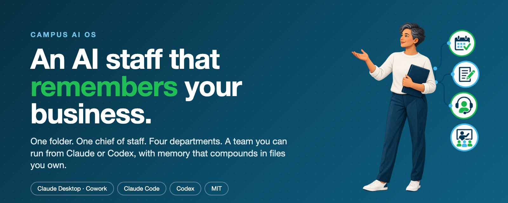
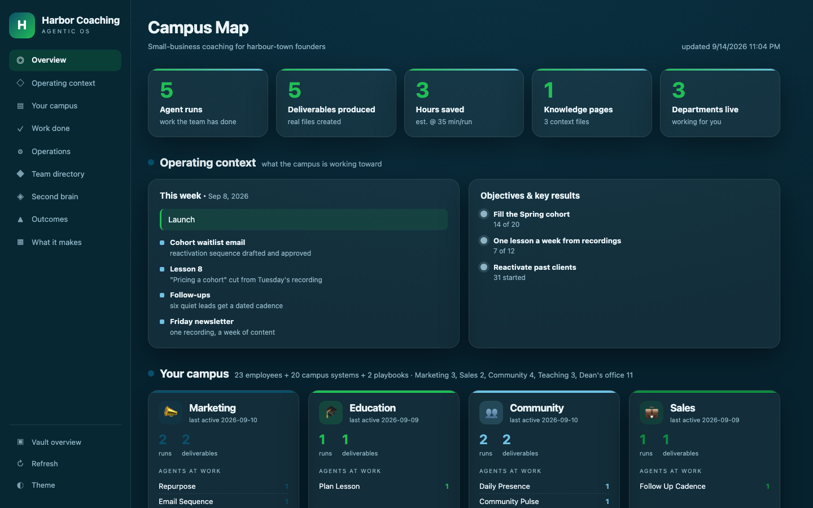
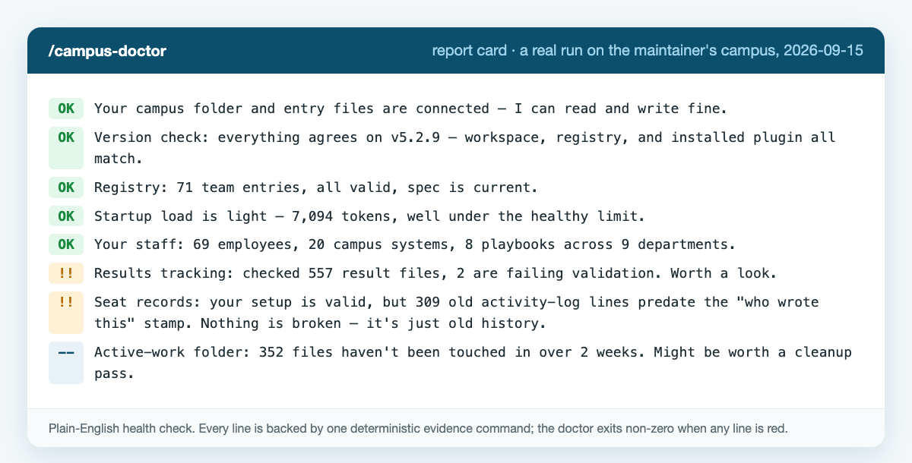
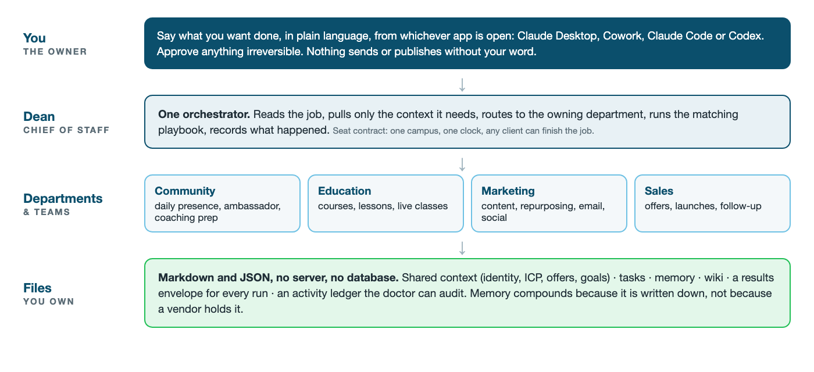

<p align="center">
  
</p>

<p align="center">
  <a href="https://github.com/trainingsites/campus-ai-os/actions/workflows/ci.yml"></a>
  <a href="LICENSE"></a>
  
  
</p>

# Campus AI OS

**Your Chief of Staff Agent. One folder, one AI you talk to, and a staff that remembers your business.**

<p align="center">
  <a href="https://trainingsites.io/"><strong>Download your Chief of Staff Agent at TrainingSites.io</strong></a>
  &nbsp;·&nbsp;
  <a href="https://trainingsites.io/members/"><strong>Get help in the community</strong></a>
</p>

This repository is the source code of the Campus AI OS kernel, kept in the open so you can read what it does before you run it. It is not the front door.

- **To get it, set it up and keep it current:** [trainingsites.io](https://trainingsites.io/). You get the install file, the setup guides and each new version.
- **For questions, help and updates:** the [TrainingSites community](https://trainingsites.io/members/). That is where support happens.
- **To update a campus you already use:** the [update guide](https://trainingsites.io/docs/campus-ai-os-update-guide/).

## Who this is for

You are an expert with clients: a coach, a consultant, a teacher, a course creator. You are also the marketing department, the sales department and the person who follows up, and there is no one to hand work to. You do not want to become a prompt engineer. You want a staff that knows your business, does the routine work well, and asks you only for the decisions that are yours.

Campus AI OS turns a folder into that business. You talk to one chief of staff. It manages the rest.

## See it work

<p align="center">
  <a href="https://www.youtube.com/watch?v=fYT-l7i99R4"></a>
  <br/>
  <sub><a href="https://www.youtube.com/watch?v=fYT-l7i99R4"><strong>How Campus OS helps run my business</strong></a> · a real week, not a demo reel</sub>
</p>

| The Campus Map | The health check |
|---|---|
|  |  |
| A private map of your campus: what the team did, what it shipped, what this week is for. This one is a fictional campus built from the kernel's own test data. | `/campus-doctor` is a plain-English health check. Every line is backed by one evidence command. |

## How it is built

<p align="center">
  
</p>

- **You** say what you want done. Nothing is sent, posted or deleted without your word.
- **Your chief of staff** is the one AI you talk to. It pulls the context a job needs, hands the job to the right department, and records what happened.
- **Departments** own the work. Playbooks carry a job from request to finished result.
- **Files you own** hold everything: your audience, offers, voice, goals, tasks, memory and a record of every run. They are plain Markdown and JSON in your folder. Open them, edit them, back them up, move them.

There is no server, no database and no API keys to manage. See [PLATFORM.md](PLATFORM.md) for how it behaves in each app, and [SECURITY.md](SECURITY.md) for exactly what it touches.

## What is new

**Update with a way back.** Updating a campus now takes a snapshot first. If something looks wrong afterwards, say "undo the last update". It shows what it would put back and waits for your go. Your memory, tasks, work diary and job cards are never touched by an undo.

**Edition check.** An update stops, with nothing written, when the installed edition does not match the one your campus was set up with.

**Claude Code first.** Setup and updates are written for Claude Code, and the same folder works in the Claude desktop app and Codex.

Every version is in [CHANGELOG.md](CHANGELOG.md). Steps for updating are in the [update guide](https://trainingsites.io/docs/campus-ai-os-update-guide/).

## Your files and your authority

1. Files in `inputs/` are source material and are never changed.
2. Nothing that cannot be undone (publishing, sending, deleting, charging, changing a live system) happens without your approval.
3. A large build begins with a short plan you can read before work starts.

## Running from source

This path is for developers who want to read or change the kernel. It comes without setup help. In Claude Code:

```text
/plugin marketplace add trainingsites/campus-ai-os
/plugin install campus-ai-os@campus-ai-os
```

Then open an empty folder and say `/campus-start`. The active niche pack (`packs/active.json`, its `identity.business_noun`) sets what kind of business your staff talks about. For Codex, see [CODEX-INSTALL.md](CODEX-INSTALL.md).

Before you send a change, run the checks:

```bash
bash tests/run-tests.sh
```

## Help

- Questions, setup help and updates: the [TrainingSites community](https://trainingsites.io/members/).
- A security problem: follow [SECURITY.md](SECURITY.md). Never post it in public.

## Documentation

- [Quick start](QUICKSTART.md)
- [Platform behavior](PLATFORM.md)
- [Codex installation](CODEX-INSTALL.md)
- [Playbooks](playbooks/README.md)
- [Changelog](CHANGELOG.md)
- [Security](SECURITY.md)

## License

The source in this repository is released under the [MIT License](LICENSE).
